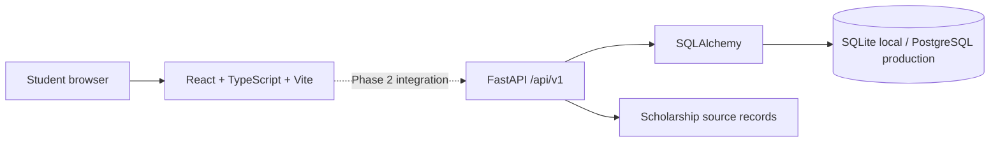

# ScholarPath architecture — Phase 1

## Current state

The React/Vite application remains the student-facing client. Its existing curated catalog and browser-only profile/tracker continue to work without a service. A new FastAPI service provides a read-only health endpoint and scholarship list endpoint backed by SQLAlchemy. The API is not connected to the React client yet; that is a later integration step once catalog synchronization and a deployment URL are configured.

## Phase 1 topology

## Trust boundaries

- The current web demo stores profile, bookmarks, checklist state, and tracker data in the browser. It does not send those values to the API.
- The Phase 1 API only exposes public scholarship listing data and health. It has no registration, login, document upload, or student-data write routes.
- Scholarship approval and eligibility are not inferred from a listing. Official sources remain the authority.
- Production authentication, role-based authorization, rate limiting, audit events, encrypted document storage, and notification delivery are later phases. Do not deploy sensitive student data until those controls exist.

## Planned deployment

- Frontend: Vercel static deployment from this repository’s root (`npm run build`, output `dist`).
- API: Render or another Python ASGI host, started with `uvicorn app.main:app --host 0.0.0.0 --port $PORT` from `backend/`.
- Database: managed PostgreSQL; supply `DATABASE_URL` in the API host. Do not commit credentials.
- Live search and AI: not enabled. Add only after choosing an authorized provider/API and setting secrets on the API host.
